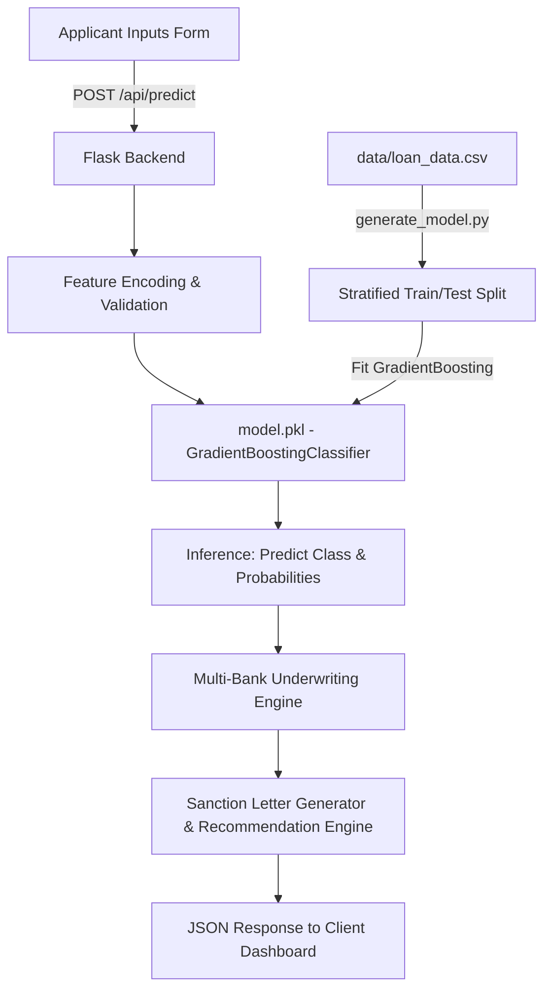

# 🏦 LoanPredict AI — Machine Learning Credit Risk & Approval System

An end-to-end Machine Learning web platform that predicts loan approval probabilities using applicant financial and demographic parameters. Built with **Flask**, **Scikit-learn**, **Pandas**, **Plotly.js**, and an interactive glassmorphism dashboard.

[](https://loan-predictor-ns16.onrender.com/)
[](https://python.org)
[](https://scikit-learn.org)
[](https://flask.palletsprojects.com)

---

## 📌 Overview

Credit risk evaluation is a fundamental problem in financial engineering. Traditional manual loan assessments are slow and prone to subjective variance. **LoanPredict AI** provides an automated decision-support pipeline that:
- Ingests 11 applicant attributes (income, loan amount, credit history, dependents, co-applicant financial data).
- Executes feature encoding and passes vectors to a tuned `GradientBoostingClassifier`.
- Outputs instant classification (Approved vs. Rejected) accompanied by confidence margins and personalized financial recommendations.
- Visualizes systemic loan approval patterns through interactive, multi-dimensional Plotly analytics.

---

## 🚀 Key Features

- **Gradient Boosting Classifier:** Trained on financial loan datasets with stratified train-test splits for robust generalization.
- **RESTful Inference API:** Fast JSON endpoint (`/api/predict`) with latency under 50ms.
- **Interactive Analytics Engine:** Dynamic Plotly.js charts exploring:
  - Approval vs. Rejection ratio
  - Applicant income distribution histograms
  - Credit history impact correlation
  - Property area (Urban / Semiurban / Rural) acceptance trends
- **Multi-Bank Eligibility Engine:** Simultaneously benchmarks applicant profiles across 10 top Indian banks (SBI, HDFC, ICICI, Axis, PNB, Kotak, Bank of Baroda, etc.) with FOIR, LTV, interest rate, and tenure criteria.
- **Official In-Principle Sanction Letters:** Generates printable, branded pre-approval loan sanction letters with digital signatures and underwriting factor breakdowns.
- **Digital Sanction Verification Portal:** Public verification page (`/verify-sanction/<id>`) allowing verification of issued sanction reference IDs.
- **Session Prediction History:** Tracks recent evaluations in memory with instant tabular review.
- **Recommendation Generator:** Rule-assisted advisory providing concrete steps (e.g. credit score remediation or co-applicant backing) when applications are high-risk.
- **Modern Responsive UI:** Glassmorphic layout with Dark/Light theme switching.

---

## 🛠️ Tech Stack

- **Backend:** Python, Flask, Gunicorn
- **Machine Learning & Data Processing:** Scikit-learn, Pandas, NumPy, Pickle
- **Data Visualization:** Plotly.py / Plotly.js
- **Frontend:** HTML5, Modern CSS3 (Glassmorphism design tokens), Vanilla JavaScript (Fetch API)

---

## 🏗️ Architecture & ML Pipeline



---

## 📂 Project Structure

```text
loan-predictor/
├── app.py                  # Flask application server, REST APIs, and chart generators
├── bank_engine.py          # Multi-bank underwriting, FOIR checks & sanction rules
├── generate_model.py       # Model training, validation, and serialization pipeline
├── model.pkl               # Serialized GradientBoostingClassifier model
├── Procfile                # Production WSGI process declaration for Render
├── requirements.txt        # Python dependency manifest
├── README.md               # Project documentation
│
├── data/
│   └── loan_data.csv       # Training dataset with applicant features & target loan status
│
├── templates/
│   ├── index.html          # Landing page & overview
│   ├── predict.html        # Prediction input form & live result card
│   ├── dashboard.html      # Interactive Plotly visual analytics dashboard
│   ├── about.html          # Methodology & model specification
│   ├── sanction_letter.html# Official printable pre-approval sanction letter
│   └── verify_sanction.html# Public digital certificate verification portal
│
└── static/
    ├── css/
    │   └── style.css       # Design tokens, dark/light themes, glassmorphism styles
    ├── js/
    │   └── main.js         # Client-side form handling, REST API integration, Plotly charts
    └── images/
        └── rajkamal_signature.png  # Digital underwriting signature
```

---

## ⚡ Installation & Local Setup

### 1. Clone the Repository
```bash
git clone https://github.com/1rajkamal/loan-predictor.git
cd loan-predictor
```

### 2. Create and Activate Virtual Environment
```bash
python -m venv venv

# Windows:
.\venv\Scripts\activate

# Linux/macOS:
source venv/bin/activate
```

### 3. Install Dependencies
```bash
pip install -r requirements.txt
```

### 4. (Optional) Retrain ML Model
```bash
python generate_model.py
```

### 5. Launch the Application
```bash
python app.py
```
Open **http://localhost:5000** in your browser.

---

## 🔌 API Reference

### `POST /api/predict`
Calculates loan eligibility and confidence.

**Request Body (JSON / Form):**
```json
{
  "gender": "Male",
  "married": "Yes",
  "dependents": "1",
  "education": "Graduate",
  "self_employed": "No",
  "applicant_income": "5000",
  "coapplicant_income": "2000",
  "loan_amount": "150",
  "loan_term": "360",
  "credit_history": "Yes",
  "property_area": "Urban"
}
```

**Response (JSON):**
```json
{
  "success": true,
  "result": {
    "approved": true,
    "probability": 0.88,
    "confidence": 76.0,
    "recommendation": "Your application shows strong financial health and credit standing.",
    "timestamp": "2026-09-01 16:45:00"
  }
}
```

---

## 🔮 Future Improvements

- [ ] Implement SHAP (SHapley Additive exPlanations) for explainable AI (XAI) feature attribution.
- [ ] Add PostgreSQL integration for persistent multi-user historical tracking.
- [ ] Deploy Dockerized container on Kubernetes cluster.
